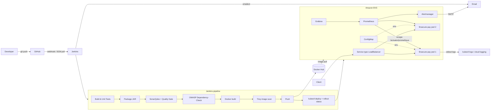

# FinSecure Pay – Design Document

## 1. Overview
FinSecure Pay is a transaction-validation API (Spring Boot 3, Java 25) delivered through an automated, security-gated CI/CD pipeline onto managed Kubernetes, with metrics, alerting and centralised log access. The goal is fast, repeatable, low-touch releases with built-in recovery.

## 2. Architecture

## 3. Tool choices and rationale
| Area | Choice | Why |
|---|---|---|
| SCM | Git + GitHub | Standard, webhooks to Jenkins |
| Build | Maven + Spring Boot | Required stack; actuator gives probes and Prometheus metrics with no extra code |
| Tests | JUnit 5 (+MockMvc) | 16 tests: validator rules and HTTP behaviour. Selenium is not used: the service is a REST API with no UI, so MockMvc covers the HTTP contract |
| CI/CD | Jenkins declarative pipeline | Pipeline-as-code in `Jenkinsfile`; credentials store; email extension |
| Container | Multi-stage Dockerfile, non-root, Temurin JRE | Small runtime image, reproducible build independent of the agent |
| Registry | Docker Hub | Free, simple; tags `1.0.<build>-<gitsha>` are immutable and traceable |
| Orchestration | Amazon EKS (managed Kubernetes, created with eksctl from `eks/cluster.yaml`) | Self-healing, rolling updates, rollback; managed control plane; cluster definition is code |
| Static analysis | SonarQube/SonarCloud with quality gate | Code smells, bugs, security hotspots |
| Dependency scan | OWASP Dependency-Check (`-Psecurity`, fails at CVSS ≥ 7) | Gate on known-vulnerable libraries |
| Image scan | Trivy (`--exit-code 1` on HIGH/CRITICAL) | Gate on OS/JRE/library CVEs in the final image |
| Monitoring | kube-prometheus-stack (Prometheus, Alertmanager, Grafana) | Standard K8s monitoring; ServiceMonitor discovers the app |
| Logging | Structured stdout → `kubectl logs` / Amazon CloudWatch Container Insights | Cloud-native logging avoids running an ELK stack for a small service |

## 4. Key design decisions
- **Stateless service, 2 replicas, `maxUnavailable: 0`** – zero-downtime rolling updates; any pod can be killed and Kubernetes recreates it.
- **Separate liveness/readiness probes** (`/actuator/health/liveness|readiness`) – traffic is only routed to ready pods; hung JVMs are restarted.
- **Configuration via ConfigMap** (`FINSECURE_MAX_AMOUNT`, `FINSECURE_ALLOWED_CURRENCIES`) – change business limits without rebuilding the image.
- **Immutable image tags** (no `latest` tag is pushed), so the tag that is scanned is the tag that is deployed. Deploys use `kubectl set image` so each release is a recorded Deployment revision (`revisionHistoryLimit: 5`) that `rollout undo` can revert to.
- **Failed rollout auto-rolls back** in the pipeline and a manual `ACTION=ROLLBACK` build is provided.

## 5. Security considerations
- Gates: unit tests → Sonar quality gate → Dependency-Check (CVSS ≥ 7) → Trivy (HIGH/CRITICAL). Any failure stops the pipeline before push/deploy.
- **No secrets in source**: Docker Hub credentials, kubeconfig, NVD API key and Sonar token live in the Jenkins credentials store; SMTP password is a Kubernetes Secret. `.gitignore` excludes `.env`, `*.pem`, `*.key`, `kubeconfig*`.
- Container runs as non-root, drops all capabilities, no privilege escalation, `RuntimeDefault` seccomp, resource limits.
- Input validation on all `/validate` fields; only `health`, `info`, `prometheus` actuator endpoints are exposed.
- Future: TLS via Ingress + cert-manager, NetworkPolicies, image signing (cosign), Vault/External Secrets.

## 6. Recovery considerations
| Failure | Recovery |
|---|---|
| Pod crash/deletion | ReplicaSet recreates it; second replica keeps serving |
| Hung application | Liveness probe restarts container |
| Bad release | `rollout status` fails → automatic `rollout undo`; or run pipeline with `ACTION=ROLLBACK` |
| Node loss | Pods rescheduled by Kubernetes (use ≥2 nodes / zones) |
| Operational anomaly | Alertmanager email (instance down, high invalid-rate, high latency, restarts) |

## 7. Logging and troubleshooting
`kubectl -n finsecure logs deploy/finsecure-pay --tail=100 -f`, `kubectl -n finsecure logs <pod> --previous` (after crash), `kubectl -n finsecure describe pod <pod>` (probe failures, events). Each validation emits `Validated transaction id=… status=… errors=…`. In the cloud, the same stdout is collected automatically (Container Insights / CloudWatch / Cloud Logging) and can be queried centrally.

## 8. AI use case: AI-assisted anomaly detection and incident triage
**Problem.** Static threshold alerts (e.g. >50 % invalid) produce noise or miss slow-burn issues (gradual latency growth, a new fraud/abuse pattern, a bad release that only affects one currency). On-call engineers then spend time correlating metrics, logs and recent deployments by hand. AI is appropriate because the signals are high-volume, seasonal and multi-dimensional, and the triage step is summarisation/correlation – tasks suited to anomaly-detection models and LLMs.

**Inputs.** Prometheus time series (request rate, status mix, p95 latency, JVM heap, restarts), application logs (validation errors by rule), deployment events (image tag, rollout/rollback history from Jenkins/Kubernetes), and alert history. Prompts: a structured incident bundle (alert, last 30 min of key metrics, top error messages, last 3 deploys) plus a runbook excerpt.

**How it would work.** (1) A seasonality-aware detector (e.g. Prophet / isolation forest / Prometheus-based z-score) flags anomalies in `/validate` rate, rejection ratio and latency. (2) On an alert, a webhook from Alertmanager calls a small service that assembles the incident bundle and asks an LLM to produce a summary, likely cause (e.g. "rejection spike began 2 min after deploy `1.0.42`") and suggested runbook step. (3) The summary is attached to the alert email/Slack and, for known-safe cases, proposes (not executes) `rollout undo`.

**Benefits.** Fewer false alerts, earlier detection of gradual degradation, shorter MTTR through automatic correlation with deployments, consistent first-line triage.

**Type.** Primarily *detection* (is the current behaviour abnormal compared with a learned baseline); prediction of trends would need longer history and a stated horizon.

**Limitations / risks / governance.** The model proposes, a named on-call engineer decides, and accountability does not transfer to the tool. It may run unattended only to detect, summarise and notify; changing the system (for example `rollout undo`) requires human review and approval; it may never deploy, delete, change security settings or access card or personal data. If the AI is wrong, the engineer ignores or overrides the suggestion, the alert still fires from the static thresholds, and the miss is recorded to improve the baseline. False positives/negatives and model drift; LLM hallucination – output is advisory with links to underlying data; no card or personal data may be sent to external models (mask account IDs, use a private/approved model endpoint); human approval required for any remediation; audit-log every AI suggestion; evaluate against historical incidents before enabling.

**Integration.** Sits beside the existing stack: reads from Prometheus and the log store, triggered by an Alertmanager `webhook_configs` receiver, and optionally called from the Jenkins post-deploy stage to compare pre/post-release metrics and recommend rollback.

## 9. Lessons learned and future improvements
- Probes and resource limits matter more than expected: wrong probe delays cause restart loops during JVM start.
- Gates are only credible if demonstrated failing – keep a controlled failing test and a known-vulnerable dependency to prove them.
- Future: Helm chart / Argo CD GitOps, HPA on CPU/RPS, Ingress with TLS, centralised ELK/Loki, canary releases with automated metric analysis, SBOM generation and image signing, the AI triage service above.
